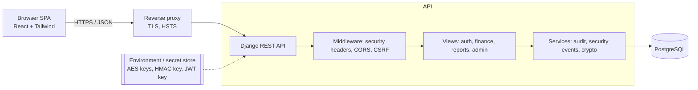
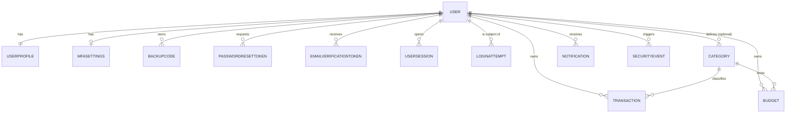

# Smart Expense Tracker: Architecture and Security Design (Phase 0)

## 1. Technology decisions

| Layer | Choice | Why |
|---|---|---|
| Backend | **Python 3.12 + Django 5.2 LTS + Django REST Framework** | Parameterised ORM (SQL-injection resistance), built-in Argon2id support, mature validation, mature test tooling |
| Database | PostgreSQL 16 | Constraints, partial unique indexes, triggers (used for the append-only audit log) |
| Auth | JWT (access + refresh) via SimpleJWT, TOTP via `pyotp` | Phase 2 and 3 |
| Crypto | `cryptography` (AES-256-GCM), `argon2-cffi` | Audited libraries, no hand-rolled primitives |
| Frontend | React + Vite + Tailwind CSS + Recharts + Lucide | As specified (Phase 6 and 7) |

One backend stack is used throughout (Django). Node/Express is not mixed in.

## 2. System architecture



## 3. Folder structure

```
smart-expense-tracker/
├── docker-compose.yml          # PostgreSQL for local dev
├── docs/                       # ARCHITECTURE.md, PROGRESS.md (+ SRS, diagrams, API docs later)
├── backend/
│   ├── config/                 # settings.py, settings_test.py, urls.py, wsgi/asgi
│   ├── apps/
│   │   ├── core/               # crypto.py, money.py, middleware.py, utils.py, shared model mixins
│   │   ├── accounts/           # User, profile, MFA, backup codes, tokens, sessions, login attempts
│   │   ├── finance/            # Category, Transaction, Budget
│   │   └── auditing/           # AuditLog (hash chain), SecurityEvent, Notification, services.py
│   ├── scripts/                # generate_secrets.py, test_on_postgres.py
│   ├── .env.example
│   └── requirements*.txt
└── frontend/                   # (Phase 6) React app: pages/, components/, api/, hooks/, theme/
```

## 4. Database design



`AuditLog` deliberately has **no foreign key** to `User`. It stores `actor_id` and an email snapshot so the trail survives account deletion and referential actions can never touch audit rows.

Data-protection map:

| Data | Storage |
|---|---|
| Password | Argon2id hash |
| Transaction amount / description / notes, budget limit | **AES-256-GCM** (`*_enc` columns) |
| TOTP secret | **AES-256-GCM** |
| Reset / verification tokens | SHA-256 of a 256-bit random token (raw token never stored) |
| MFA backup codes | Argon2id hash, single use |
| Transaction date, category, type | Plaintext (needed for indexing and filtering) |
| Audit log | Plaintext metadata **without financial values** (enforced in code), HMAC-chained |

Every user-owned table carries `user_id`; all querying goes through `OwnedQuerySet.for_user()`.

## 5. Security architecture

### 5.1 Threat → control map

| Risk (OWASP 2021) | Control | Status |
|---|---|---|
| A01 Broken access control / IDOR | `for_user()` scoping on every query, object-level ownership checks, role checks, admins have **no** route to transaction data | Model layer ✅ · API Phase 4–5 |
| A02 Cryptographic failures | AES-256-GCM with random nonces, key IDs, context-bound AAD, env-only keys, Argon2id | ✅ tested |
| A03 Injection | ORM only (no raw SQL with user input), serializer validation, strict JSON parser | Phase 2+ |
| A04 Insecure design | Admin/financial-data separation, single-use tokens, TOTP replay protection, append-only audit | ✅ models · Phase 2–5 logic |
| A05 Misconfiguration | Fail-closed settings, `check --deploy` clean, HSTS/secure cookies, no Django admin, no default secrets | ✅ tested |
| A07 Authentication failures | Lockout, throttling, uniform responses, MFA, refresh rotation with reuse detection | Phase 2–3 |
| A08 Integrity failures | Hash-chained audit log; DB trigger blocks UPDATE/DELETE/TRUNCATE | ✅ tested (SQLite + PostgreSQL) |
| A09 Logging failures | Audit trail + security events + dashboards | ✅ services · Phase 5 dashboards |
| XSS | JSON-only API, strict CSP header, React escaping, no `dangerouslySetInnerHTML` | Header ✅ · UI Phase 6–7 |
| CSRF | Access token in `Authorization` header; refresh cookie is HttpOnly + `SameSite=Strict` + CSRF double-submit | Phase 2 |
| Brute force | Per-IP/per-account throttles plus temporary account lockout | Phase 2 |

### 5.2 Encryption design

- Token format `v1.<kid>.<base64(nonce‖ciphertext‖tag)>`, 256-bit keys, fresh 96-bit random nonce per write.
- **AAD = table | field | user id | row id.** A ciphertext copied to another row, user or field fails authentication (tested).
- Key rotation: add `k2`, set it active; old rows stay readable; `rewrap()` migrates them.
- Failures raise one generic `DecryptionError`, which gives no decryption oracle.
- **Trade-off (documented):** encrypted amounts cannot be summed in SQL. Totals, charts and search run in the application on the authenticated user's own decrypted rows. This is acceptable at personal-finance scale, and dates, categories and types stay indexed.

### 5.3 Authentication and session design (Phase 2)

- Access JWT: 10 minutes, held in memory only. Refresh JWT: 7 days, `HttpOnly; Secure; SameSite=Strict`, path-scoped to the auth routes.
- Each login creates a `UserSession`; its id is the `sid` claim. Refresh **rotates** `current_jti`; presenting an old one is treated as theft and the session is revoked (and a security event is recorded).
- Every request validates that the session is unrevoked, so logout, suspension and password change take effect immediately.
- Lockout: 5 failures → 15 minutes (configurable). Login, register and reset return uniform responses to prevent account enumeration.
- Password policy: ≥ 12 characters, common/numeric/similarity validators, plus a strength meter endpoint.

### 5.4 MFA and suspicious-login detection (Phase 3)

- TOTP secret is generated server-side, shown once as a QR code, and MFA is enabled **only after a valid OTP** is submitted. Each time-step is single-use (`last_used_step`). Ten Argon2-hashed backup codes are provided.
- Heuristics, all based on data we actually hold: (1) first-seen IP *and* user agent for an established account, (2) success right after repeated failures, (3) one IP failing against many accounts (credential stuffing). Without a GeoIP database, "impossible travel" is **not** claimed.

### 5.5 RBAC

- `admin` manages users, suspension and security events. `user` sees only their own data.
- Admin serializers contain no financial fields and no admin route exposes transactions or budgets. Automated tests will assert an admin token receives 403/404 there.

### 5.6 Audit and tamper evidence

- `entry_hash = HMAC-SHA256(key, prev_hash | canonical row)`. Edits or deletions mid-chain are detected by `verify_chain()`.
- Three layers: ORM refuses update/delete → PostgreSQL trigger refuses UPDATE/DELETE/TRUNCATE → HMAC chain detects tampering that bypasses both. In production, also run the app as a DB role with only `INSERT, SELECT` on the audit table.
- Audit `details` may carry ids and field names only. Keys such as `amount`, `notes`, `password`, `token` are rejected at write time.

## 6. Phased plan

See `PROGRESS.md`. Phases 1 → 8, each ending with tests, a file list and run commands.

## 7. Known limitations (will be restated in the final report)

- Keys live in environment variables. Production should use a KMS or secrets manager, with per-user data keys as a future improvement.
- Rate-limit counters use the default in-process cache; multi-worker production needs a shared cache such as Redis (Phase 8 deployment notes).
- Truncating the *tail* of the audit log is detectable only against an externally stored anchor (e.g. periodic export of the latest hash).
- Automated tests demonstrate that specific controls work. They do not prove the system is "secure"; Phase 8 will state the scope and residual risks.
